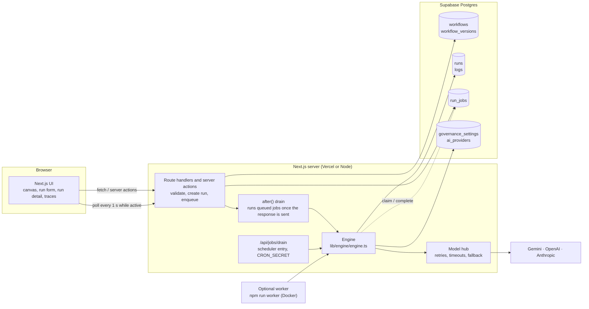
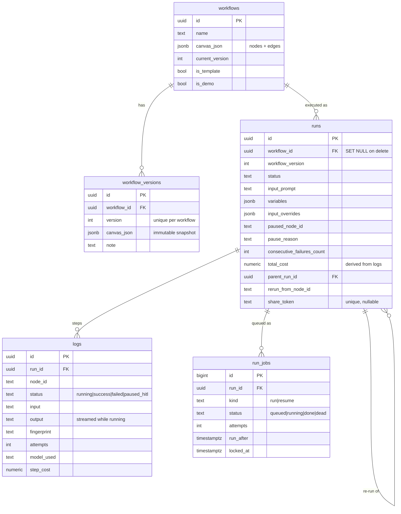
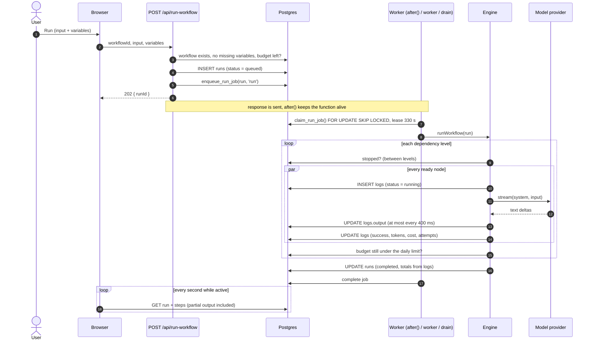
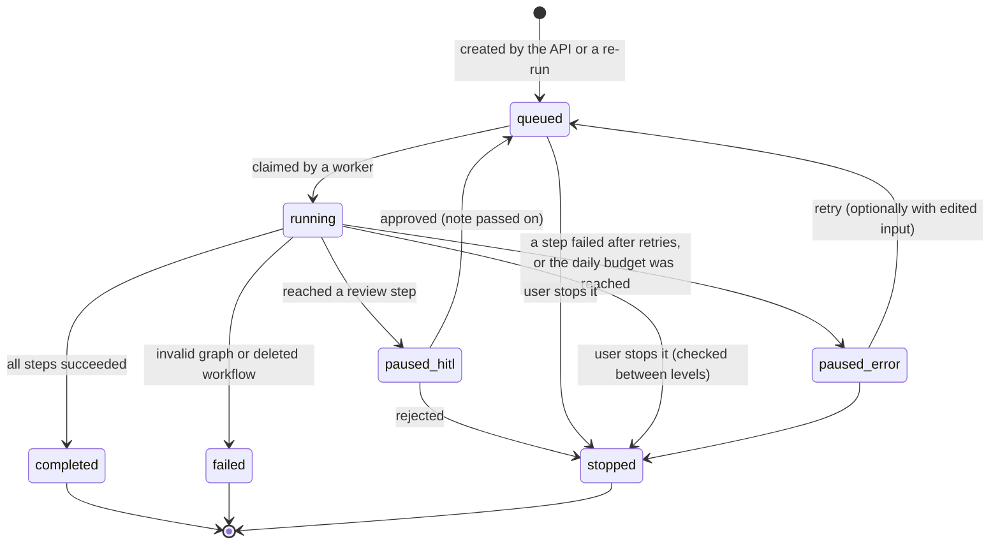

# HiveState architecture

HiveState runs multi-agent LLM workflows. A workflow is a directed acyclic graph drawn on a canvas: each node is an
agent (a model plus a system prompt) or a human review step, and each edge passes one step's output to the next.
This document describes how the system is put together, how a run moves through it, what happens when things fail,
and where it stops scaling.

Contents

1. [Components](#1-components)
2. [Data model](#2-data-model)
3. [Run lifecycle](#3-run-lifecycle)
4. [Execution engine](#4-execution-engine)
5. [Failure handling](#5-failure-handling)
6. [Model layer](#6-model-layer)
7. [Security](#7-security)
8. [Scaling limits](#8-scaling-limits)
9. [Trade-offs and alternatives](#9-trade-offs-and-alternatives)
10. [Testing](#10-testing)

## 1. Components



| Component | Where | Responsibility |
|---|---|---|
| UI | `app/`, `components/` | Canvas editor (React Flow), run form with variables and cost estimate, run detail with streaming steps, history, trace search, share page. |
| API | `app/api/*`, `app/actions/*` | Input validation, run creation, enqueueing, re-run, share links, versions. Never executes a workflow inside the request. |
| Queue | `lib/queue/*`, table `run_jobs` | Durable list of runs to execute. Claimed with `FOR UPDATE SKIP LOCKED`, protected by a lease. |
| Engine | `lib/engine/engine.ts` | Schedules the DAG level by level, persists every step, pauses for review, errors and budget. Pure TypeScript with injected dependencies. |
| Store | `lib/store/*` | `RunStore` interface. `SupabaseStore` in the app, `MemoryStore` in tests. |
| Model hub | `lib/models/*` | Routes a model ID to its provider, streams output, applies retries, timeouts and the fallback model, prices tokens. |
| Workers | `after()`, `scripts/worker.ts`, `/api/jobs/drain` | Three ways to drain the same queue (see [section 3](#3-run-lifecycle)). |

## 2. Data model



Notes on the model:

- **A step row is the unit of truth.** Run totals (`total_cost`, `total_tokens`) are recomputed from the step rows
  every time the run is updated, so the run summary can never disagree with the trace.
- **Versions are immutable.** `save_workflow_version()` locks the workflow row, compares the canvas with the latest
  version and inserts version N+1 only when it changed. Every run records the version it ran, so "which prompt
  produced this output?" always has an answer. Restoring an old version creates a new version; history is append-only.
- **Deleting a workflow keeps its runs** (`ON DELETE SET NULL`), so spend history and budgets stay correct.
- **`get_today_spend()`** sums `logs.step_cost` since midnight and is backed by an index on `logs.created_at`.

## 3. Run lifecycle

### Sequence



### States



`resumed` is a short-lived status written when a paused run is picked up again; it behaves like `running`.

### Who drains the queue

The queue has one consumer contract (`drainQueue`) and three ways to invoke it. They can run together because
claiming is atomic.

| Trigger | When it runs | Good for |
|---|---|---|
| `after()` in the request that queued the run | Right after the response is sent; lives up to the route's `maxDuration` (300 s) | Serverless hosting with zero extra infrastructure. |
| `npm run worker` | Polls every 2 s (`WORKER_POLL_MS`) | Self-hosting, long runs, several replicas. Set `HIVESTATE_INLINE_DRAIN=0` on the web app. |
| `GET /api/jobs/drain` with `Authorization: Bearer $CRON_SECRET` | From a scheduler (the included GitHub Actions workflow runs every 15 min) | Recovering jobs whose worker was cut off. |

## 4. Execution engine

The engine (`lib/engine/engine.ts`) has no framework or database imports; it receives a `RunStore` and a `ModelHub`.

**Scheduling.** The canvas is validated (non-empty, acyclic using an iterative DFS, at least one root). Then, until
every node has succeeded: find the nodes whose parents have all succeeded, and run them in parallel with
`Promise.all`. A node's input is the run input for a root, the parent's output for one parent, or a labelled JSON
envelope `{"inputs":[{"source_node","content"}]}` when branches merge. The merging agent is told about the format.

**State is rebuilt from the database on every entry.** `runWorkflow` reads the run's step rows, marks successful nodes
as done and restores their outputs. This single code path handles a first run, a resume after review, a retry after
an error, a re-run from a step, and a worker that crashed mid-run. Steps left in `running` by a dead worker are marked
failed (`INTERRUPTED`) and executed again.

**Idempotency.** Each step has a fingerprint `sha256(run, node, input, system prompt)`. If a successful step with
the same fingerprint exists it is reused at zero cost. Together with "successful steps are never re-run", this makes
at-least-once job delivery safe.

**Variables.** `{{name}}` placeholders in prompts and input are filled from `runs.variables`. The run endpoint
refuses a run with missing variables; unknown placeholders are left visible in the trace instead of silently removed.

**Review steps.** A `HITLNode`, or an agent with "review before running", pauses the run and records a
`paused_hitl` step holding the input under review. Approving marks that step successful (with an optional note) and
re-queues the run. For a review node the input passes through to its children; for a flagged agent the agent then runs,
with the note appended to its input.

**Re-run from a step.** `prepareRerun` creates a new run linked to the original, copies the successful results of
every step that is neither the chosen step nor downstream of it (as zero-cost, `is_skipped` rows), and queues it. The
engine sees those steps as done and only executes the chosen step and its descendants.

**Streaming.** A step row is inserted as `running` before the model is called. Deltas are buffered and written at most
every 400 ms with at most one write in flight; the final result overwrites the partial text. The UI polls the run every
second while it is active, so output appears progressively without WebSockets.

**Cost estimate.** `estimateRunCost` walks the levels: input tokens are counted from the real prompts (about 4
characters per token), each agent is assumed to produce `expectedOutputTokens` (700 by default), and that output becomes
the next step's input. It reports a low/expected/high range and compares the high end with today's remaining budget.

## 5. Failure handling

| Failure | Detection | Response |
|---|---|---|
| Rate limit, 5xx, network error, provider overloaded | HTTP status or message on the SDK error | Retry the same model up to `retries` times (default 2, max 5) with exponential backoff and jitter (0.5 s to 8 s). |
| Slow model | Per-attempt timer (`timeoutMs`, default 90 s) | The request is aborted through `AbortSignal` and counted as a transient failure. |
| Model keeps failing, has no key, or refuses | Retries exhausted, `ProviderNotConfiguredError`, `ModelRefusalError` | Fall back once to the fallback model from Settings, with the same retry budget. The step records `fallback_triggered`. |
| Bad request (400) or invalid prompt | Non-transient error | No retry. The step fails; the run pauses with `paused_error`. Sibling steps that succeeded are kept. |
| Same run fails repeatedly | `consecutive_failures_count` reaches 3 | Circuit breaker: the run is marked halted and needs an explicit "Reset and retry". |
| Daily budget | Checked before a run starts (HTTP 402) and after every level | New runs are refused; a running run pauses with `pause_reason = budget_limit` instead of overspending. |
| Invalid workflow (cycle, empty, deleted) | Engine validation | Run is `failed` with a readable message; the job is completed, not retried. |
| Worker or function killed mid-run | Job lease (330 s) expires | Another worker reclaims the job; interrupted steps are re-executed, finished steps are not. |
| Infrastructure error (database unreachable) | Engine throws while the run is not terminal | Job retried with backoff (15 s, 30 s, ...) up to 3 attempts, then marked `dead` and the run `failed`. |
| Queue table missing (migration not applied) | `enqueue` fails | Falls back to running inside `after()` and logs a warning; the sidebar shows "apply the latest migration". |
| Double click on Run/Resume | Unique partial index on `run_jobs(run_id) WHERE status IN (queued, running)` | The second enqueue is a no-op. |
| User stops a run | `runs.status = stopped` | The engine checks between levels; a queued job for a stopped run is completed without executing. |

## 6. Model layer

`lib/models/catalog.ts` lists models with their provider and price; `lib/models/hub.ts` turns a call into
provider requests with retries and fallback; `lib/models/providers/*` adapt each SDK to one interface:

```ts
generate({ model, system, prompt, signal, onDelta, maxOutputTokens }) => { text, inputTokens, outputTokens }
```

| Provider | SDK | Streaming | Usage counted |
|---|---|---|---|
| Google Gemini | `@google/generative-ai` | `generateContentStream` | prompt and candidate tokens |
| OpenAI | `openai` (Chat Completions) | `stream: true`, `include_usage` | prompt and completion tokens |
| Anthropic | `@anthropic-ai/sdk` | `messages.stream`, `finalMessage()` | input (including cache reads and writes) and output tokens |
| Mock | built in | word by word | estimated, cost 0 |

SDK-level retries are turned off (`maxRetries: 0`) so there is exactly one retry policy. Keys are read from
environment variables first, then from keys saved in Settings (cached for 60 s and invalidated on save).
Retired model IDs in older canvases (`gemini-1.5-*`, `gemini-2.0-flash`, `gpt-4o*`) are mapped to current ones.
Costs are list prices in USD converted to INR (`USD_INR_RATE`, default 88), the currency of the budget.

## 7. Security

- **Single-tenant by design.** There are no user accounts; whoever can open the app can use it. Deploy it privately,
  behind your platform's access protection, or as a public demo with `DEMO_MODE=1`. Multi-tenancy would add Supabase
  Auth, an `owner_id` on every table and RLS policies keyed on `auth.uid()`.
- **Database access is server-only.** The service-role client is imported only from server code (`server-only`), and
  every table has RLS enabled with no policies, so the public anon key can read nothing. SQL functions revoke
  `EXECUTE` from `anon` and `authenticated`.
- **Provider keys** never reach the browser. Saved keys are masked when listed. Environment variables take precedence.
- **Share links** use 24 random bytes (base64url), are stored with a unique index, can be revoked instantly, expose one
  run read-only, and are marked `noindex`.
- **Input validation.** Run requests check the workflow ID format, input size (200 000 characters), variable names
  and sizes; free-text search is sanitised before being placed in a PostgREST filter.
- **The drain endpoint** is disabled unless `CRON_SECRET` is set and compares the bearer token in constant time.
- **Prompt injection** is out of scope for the engine: agent outputs are treated as untrusted text and passed to the
  next model, never executed. Review steps are the control for sensitive actions.

## 8. Scaling limits

| Dimension | Current limit | What gives first | Next step |
|---|---|---|---|
| Run length on serverless | Up to `maxDuration` (300 s) per drain, then the lease hands the job to the next drain | A run longer than one invocation continues only when the next drain fires | Run `npm run worker` (no time limit) or shorten steps. |
| Throughput | One Postgres row lock per claim; each worker runs one run at a time | Database connections and provider rate limits long before the queue | More worker replicas; `SKIP LOCKED` scales to many consumers. |
| Parallelism inside a run | Every ready node in a level runs at once | Provider rate limits on wide graphs | A per-provider concurrency limit (semaphore) in the hub. |
| Step output size | Stored as `text` in one row; streamed writes rewrite the whole value | Very long outputs (MBs) make each flush heavier | Append-only chunk table, or flush less often for long outputs. |
| Live updates | Polling every 1 s per open run page | Many viewers multiply reads | Supabase Realtime on `logs` (the tables are already in the publication). |
| History pages | Run history loads the latest 500 runs; traces are paginated server-side | Filtering 500 rows client-side | Move run-history filters to SQL with keyset pagination. |
| Search | `ILIKE` over step text | Sequential scans as `logs` grows | `pg_trgm` GIN index or a `tsvector` column. |
| Budget check | `SUM(step_cost)` over today's steps, indexed by time | Millions of steps per day | A daily spend counter updated in the same transaction as the step. |

## 9. Trade-offs and alternatives

**Postgres as the queue instead of Redis/BullMQ or Kafka.** The run row, its steps and its job live in one database,
so enqueueing and status changes are consistent without a second system, and there is nothing extra to host or pay
for. `FOR UPDATE SKIP LOCKED` gives safe concurrent consumers and the lease gives crash recovery. The cost is polling
latency (bounded by the poll interval) and a ceiling of roughly hundreds of jobs per second, far above what LLM-bound
work needs. BullMQ would add a Redis dependency for features this workload does not use; Kafka is a log, not a job
queue, and would still need per-job state elsewhere.

**`after()` instead of a mandatory worker.** It lets the hosted demo run on a free serverless tier with no extra
process. Its limit is the function duration, which the lease and the drain endpoint cover. Self-hosters get a real
worker with the same code.

**Level-by-level scheduling instead of a fully event-driven scheduler.** A node waits for its whole level, so a fast
branch can wait for a slow sibling. In exchange, pause, stop and budget checks happen at clean boundaries, and the
engine stays small enough to reason about and test. Switching to "start a node as soon as its own parents finish" is
a local change in the loop.

**Polling instead of WebSockets or Server-Sent Events.** Streaming text is written to the step row and polled. This
survives serverless functions, reconnects and page reloads for free, at the cost of up to a second of latency and some
extra reads. Supabase Realtime is the drop-in upgrade.

**Rebuilding state from the database instead of keeping it in memory.** Every resume reads the steps again. It costs a
few queries per level and removes a whole class of bugs: there is no in-memory state that can be lost or diverge.

**Recording versions on save instead of on every edit.** Edits are cheap and frequent; versions are meaningful
checkpoints, and every run points at one. Undo/redo inside the editor covers fine-grained changes.

**Costs in INR from a static price table.** Budgets need a number before the provider bill arrives. The table is easy
to update, and the per-step `model_used` and token counts allow recomputing costs later if prices change.

## 10. Testing

`npm test` runs Vitest suites that need no network or database:

- `tests/engine/runner.test.ts` exercises the real engine with `MemoryStore` and a scripted provider behind the real
  model hub: ordering, parallel levels, merges, variables, streaming writes and cost, retries, timeouts, fallback,
  partial failure and resume, circuit breaker, review steps, edited inputs, stop, crash recovery, budget guard and
  re-run from a step.
- `tests/queue/worker.test.ts` covers one live job per run, lease expiry, backoff, dead jobs and the worker's
  handling of business versus infrastructure errors.
- `tests/api/routes.test.ts` calls the route handlers directly with in-memory backends: validation, status codes
  (400, 402, 404, 413, 422), re-run, share links and the drain endpoint's authentication.
- Unit suites for the graph, templates, retry policy, cost estimate, model catalogue, hub, Anthropic adapter and
  canvas history.

CI (`.github/workflows/ci.yml`) runs lint, typecheck, tests and a production build, and in a second job replays every
migration on Postgres 16, applies the demo seed twice and asserts the result (`scripts/db-replay.sh`).
